# COMP 479/6791 Project 1 — Demo

Run all commands from the project root.

The screenshots in `demo/screenshots/` were taken from actual runs of these commands in a Windows PowerShell console on 2026-10-18. The yellow `PS>` line above each output is the command that was run.

## 0. Setup

```powershell
python -m venv .venv
.\.venv\Scripts\python.exe -m pip install -r requirements.txt
.\.venv\Scripts\python.exe -c "import nltk; nltk.download('punkt_tab')"
```

Place the Reuters-21578 files (`reut2-000.sgm` … `reut2-021.sgm`) in `data/raw/reuters21578/`.

Environment used for the demo (Python 3.13.0, packages, 22 Reuters files, source files):

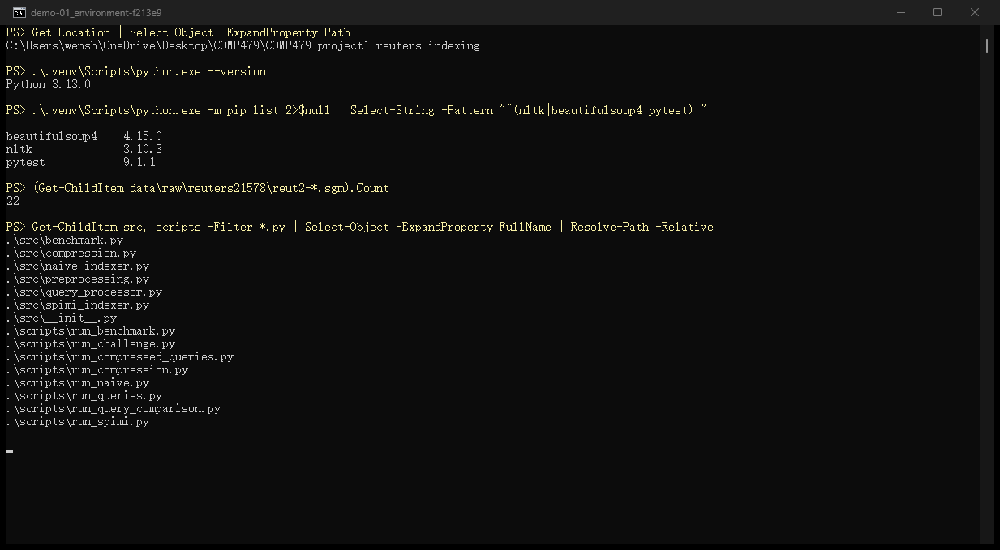

---

## 1. Naive Indexer

```powershell
.\.venv\Scripts\python.exe -m scripts.run_naive
```

Expected:
- Builds Reuters-21578 inverted index
- Uses `NEWID` as DocID
- About `74,870` terms

Main idea:

```text
documents
→ (term, docID) pairs F
→ sort
→ deduplicate
→ inverted index
```

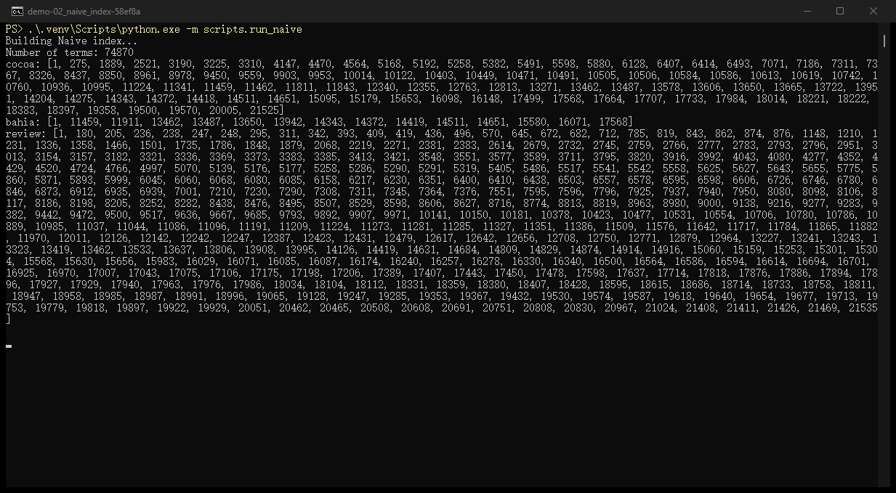

---

## 2. Query Processor

```powershell
.\.venv\Scripts\python.exe -m scripts.run_queries
```

Sample queries:

```text
cocoa
bahia
review
cocoa AND bahia
cocoa AND review
bahia AND review
```

Expected result counts:

| Query | Results |
|---|---:|
| cocoa | 97 |
| bahia | 15 |
| review | 373 |
| cocoa AND bahia | 10 |
| cocoa AND review | 5 |
| bahia AND review | 4 |

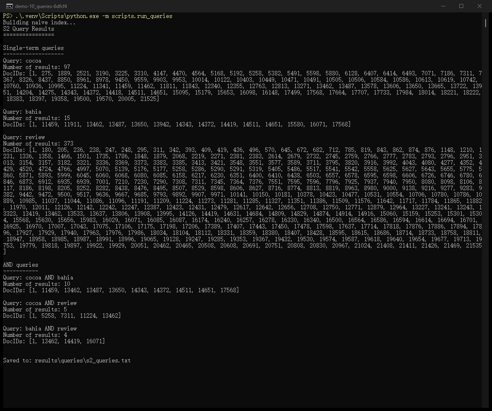

---

## 3. Compression Experiment

```powershell
.\.venv\Scripts\python.exe -m scripts.run_compression
```

Main stages:

```text
unfiltered
→ no numbers
→ case folding
→ stopword removal
→ stemming
```

Key observations:

- Removing numbers reduces many terms.
- Stopword removal barely changes term count but greatly reduces postings.
- Stemming greatly reduces term count by merging related word forms.

Final cumulative reduction:

```text
Terms:    -54.0%
Postings: -48.4%
```

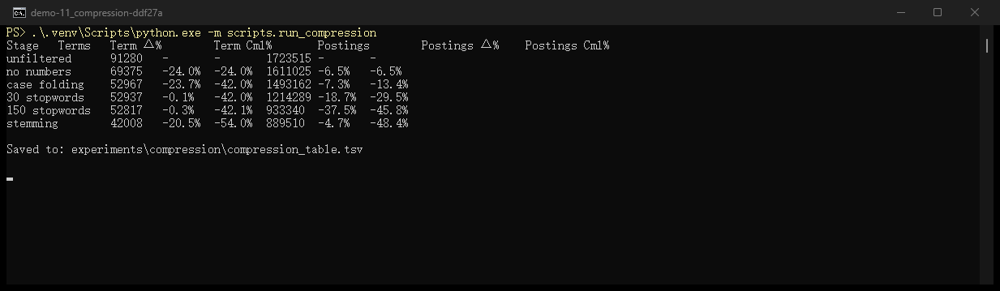

---

## 4. Original vs. Compressed Queries

```powershell
.\.venv\Scripts\python.exe -m scripts.run_query_comparison
```

Key example:

```text
review
Original:   373
Compressed: 488
```

Reason: stemming merges forms such as `review`, `reviews`, `reviewed`, and `reviewing`.

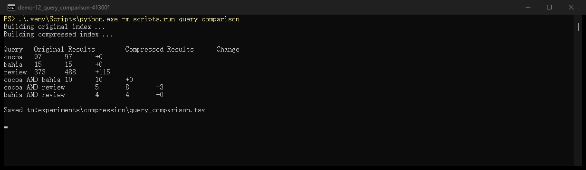

---

## 5. SPIMI-Inspired Indexer

```powershell
.\.venv\Scripts\python.exe -m scripts.run_spimi
```

Main difference:

```text
Naive:
build full F → sort all pairs → build index

SPIMI:
read term → directly append docID to postings list
```

SPIMI avoids sorting the complete term-docID pair list.

Same number of terms (74,870) and same postings for `cocoa`, `bahia` and `review` as the naive index:

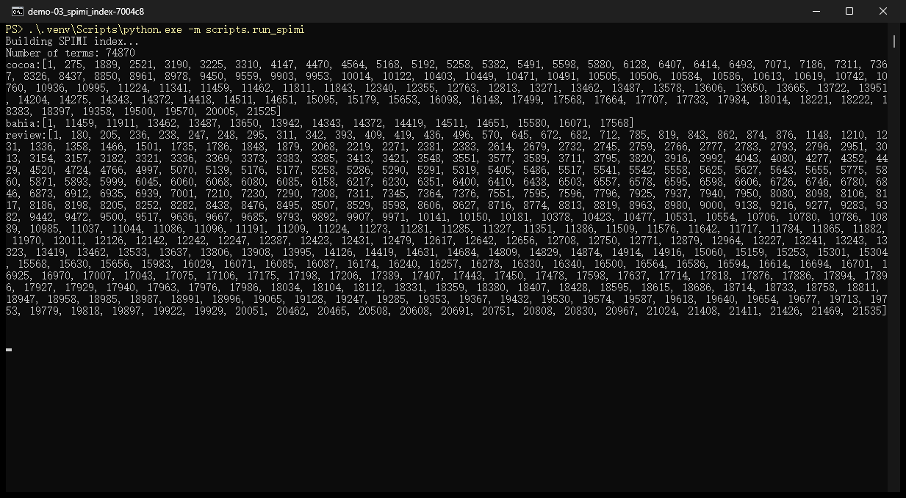

---

## 6. Benchmark

```powershell
.\.venv\Scripts\python.exe -m scripts.run_benchmark
```

Previous result:

```text
Average Naive time: 0.005808 s
Average SPIMI time: 0.001528 s
SPIMI speedup: 3.80x
Indexes identical: True
```

Timing may vary slightly between runs.

Saved output of the run used in the report (shown from the file so the numbers match Section 6.3 of the report):

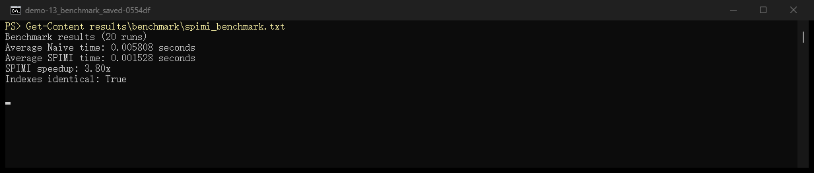

---

## 7. Tests

```powershell
.\.venv\Scripts\python.exe -m pytest -v
```

Expected:

```text
15 passed
```

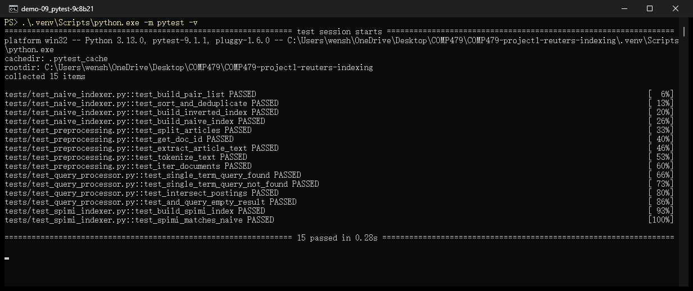

---

## 8. Challenge Queries

Official queries, run on both the naive and the SPIMI-inspired index:

```text
1. Carmark
2. copper
3. Chrysler and Bundesbank
```

```powershell
.\.venv\Scripts\python.exe -m scripts.run_challenge
```

The script parses the collection once, builds both indexes from the same documents, runs the three queries on each index, checks the results, and saves:

- `results/challenge/challenge_results.txt`
- `results/challenge/challenge_timings.txt`

`and` in the third query is the Boolean AND operator, so the operands are `['Chrysler', 'Bundesbank']`.

### 8.1 Run

End of the console output: all correctness checks passed, timings, exit code 0.

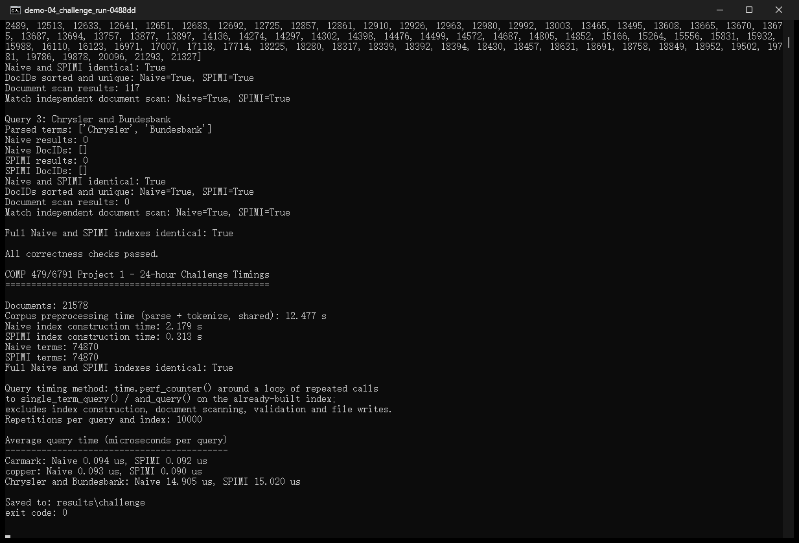

### 8.2 Carmark

1 document, NEWID 19758, in both indexes.

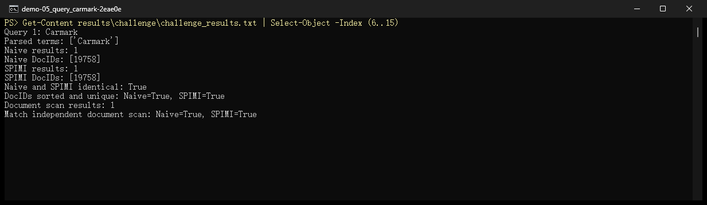

### 8.3 copper

117 documents, same DocIDs in both indexes.

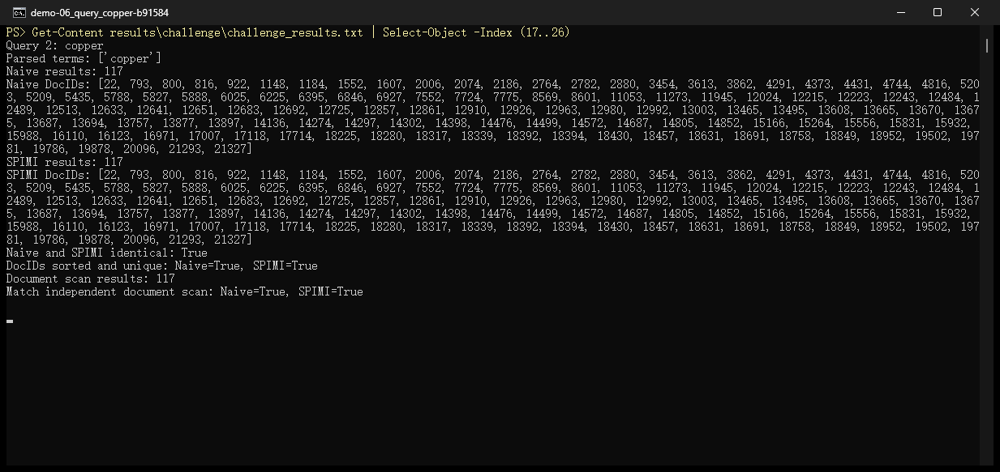

### 8.4 Chrysler AND Bundesbank

0 documents in both indexes. The second command shows that both terms exist (125 and 167 documents) but never appear in the same document, so the empty result is correct.

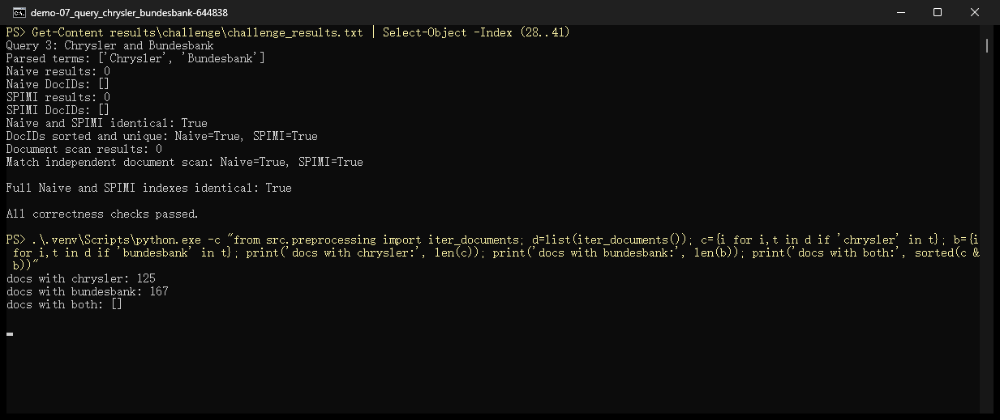

### 8.5 Consistency and validation

For every query:

- naive result = SPIMI result
- DocIDs sorted and unique
- both match an independent scan of the preprocessed documents

The complete naive and SPIMI indexes are also identical (74,870 terms). See the "identical", "sorted and unique" and "Match independent document scan" lines in 8.2–8.4, and "Full Naive and SPIMI indexes identical: True" in 8.4.

### 8.6 Timing

| Step | Time |
|---|---:|
| Parse + tokenize (shared) | 12.477 s |
| Naive construction | 2.179 s |
| SPIMI construction | 0.313 s |

Average query time over 10,000 repetitions:

| Query | Naive | SPIMI |
|---|---:|---:|
| Carmark | 0.094 µs | 0.092 µs |
| copper | 0.093 µs | 0.090 µs |
| Chrysler AND Bundesbank | 14.905 µs | 15.020 µs |

SPIMI is about 7x faster to build, while query times are the same within noise (both produce the same dictionary).

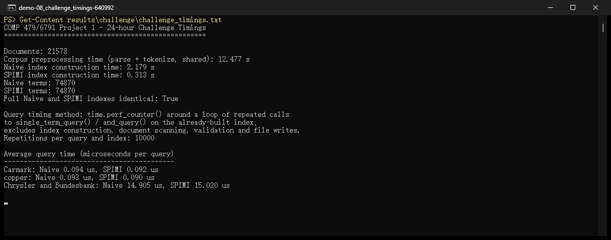

---

## Demo Order

```text
run_naive
→ run_queries
→ run_compression
→ run_query_comparison
→ run_spimi
→ run_benchmark
→ pytest
→ challenge queries
```
